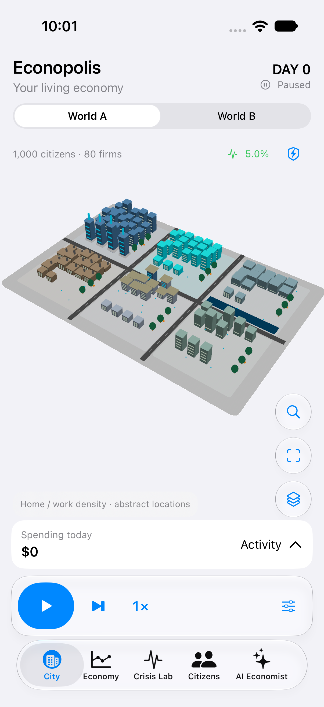
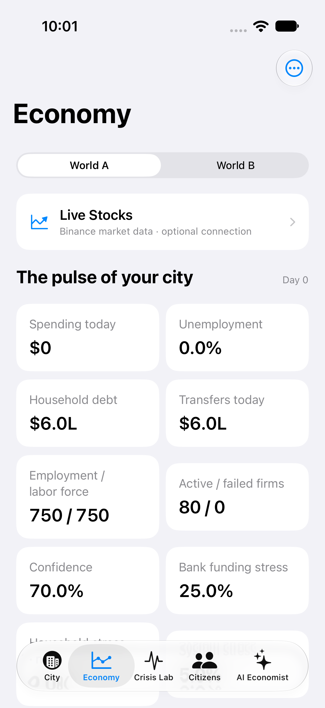
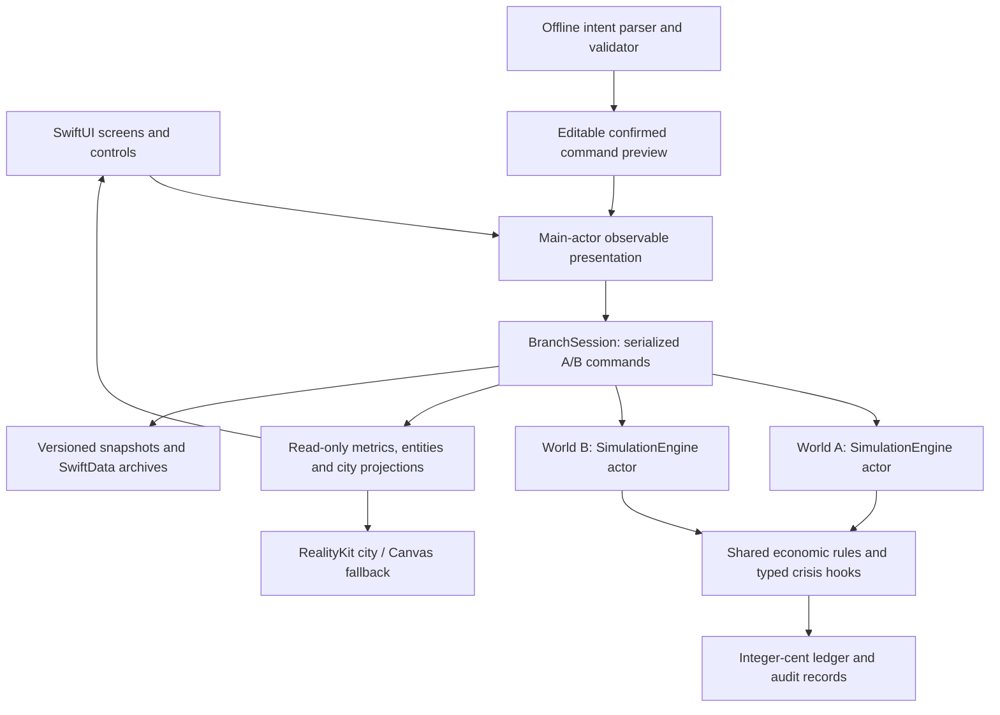

<div align="center">

# ECONOPOLIS

### The Living Financial City

**Explore a city. Trigger a crisis. Rewind the economy. Compare two futures.**

A native iPhone financial simulation built with Swift 6, SwiftUI and RealityKit. Offline simulated economy, with an optional online stock-quote reference.

[iPhone app](#run-the-app) · [Features](#features) · [Live demo](#the-great-bank-run-live-demo) · [Architecture](#how-it-works) · [Test results](#builds-tests-and-measured-performance)

</div>

---

## What is ECONOPOLIS?

ECONOPOLIS is an interactive, synthetic economy presented as a miniature financial city. Citizens earn income, buy goods, hold deposits, repay loans and respond to changing financial conditions. Businesses receive revenue, pay workers, borrow and experience cash-flow stress. Banks, the municipal treasury and central bank connect those decisions into one financial system.

You can explore that system, introduce a shock, observe its calculated consequences and replay the same starting conditions with a different policy. The app's central experience is:

**Open City → Trigger Crisis → Observe Disruption → Rewind → Intervene → Compare Futures → Explain Results**

The city, charts, transactions and explanations read actual simulation state. Outcomes are computed by the Swift engine, including in the guided demo.

> **Educational purpose:** ECONOPOLIS helps explain economic relationships, payment disruption and policy tradeoffs. It is a fictional mechanism model, not a forecast of actual banks, markets or government policy, and not personal financial advice.

## What is it for?

- **Learning:** see how income, consumption, debt, employment and payment systems affect one another.
- **Scenario exploration:** experiment with crises and interventions without risking real money.
- **Comparing decisions:** replay the same economy and compare an unassisted future with a policy response.
- **Hackathon demonstrations:** present a repeatable financial-crisis story that runs without login, internet or API keys.
- **Further development:** extend a testable economic core independently of its iPhone presentation and renderer.

## See the app

These are actual iPhone Simulator captures, not design mockups. Values shown belong to calculated simulation runs.

<table>
  <tr>
    <td align="center"><strong>Native iOS city · Light appearance</strong></td>
    <td align="center"><strong>Live financial metrics</strong></td>
  </tr>
  <tr>
    <td align="center"></td>
    <td align="center"></td>
  </tr>
</table>

Native design: [Light Economy](docs/Screenshots/NativeUI/Light-Economy.png), [Dark Crisis Lab](docs/Screenshots/NativeUI/Dark-CrisisLab.png), and [Light Economist](docs/Screenshots/NativeUI/Light-Economist.png). See the [Apple-guided refresh notes](docs/APPLE_UI_REFRESH.md).

More captures: [banking heatmap](docs/Screenshots/BankingHeatmap.png), [citizen inspector](docs/Screenshots/CitizenInspector.png), [offline economist](docs/Screenshots/OfflineEconomist.png), and [normal app launch](docs/Screenshots/FinalStandaloneLaunch.png). Capture provenance is recorded in [Screenshots/README.md](docs/Screenshots/README.md).

## The simulated world

| Entity | Default world |
|---|---:|
| Citizens / households | 1,000 |
| Businesses | 80 |
| Commercial banks | 4 |
| Districts | 6 |
| Household economic archetypes | 12 |
| Central bank | 1 |
| Municipal treasury | 1 |

One household represents one citizen. Archetypes cover students, service workers, technology workers, industrial workers, gig workers, business owners, retirees and other economic groups. Individuals have seeded personal variation rather than identical finances or behavior.

The six districts are **Financial Core, Innovation Quarter, Harbor District, Industrial Zone, University District and Residential Heights**. Their industries, income and consumption characteristics influence the economy. Layout and personal variation are reproducible from the simulation seed. Population and seed are configurable in the core.

## Features

### 1. Interactive financial city

- Procedural **RealityKit 3D city**, using a virtual camera without AR tracking or camera permission.
- Six distinct neighborhoods with banks, offices, shops, factories, warehouses, residential groups, streets, green spaces and harbor details.
- Stable mappings from real businesses and banks to their visual buildings.
- **One-finger drag** to orbit, **two-finger drag** to pan and **pinch** to zoom.
- Tap to select, long press for contextual details and double tap to focus the selected entity or reset framing.
- Separate camera reset and entity-focus controls; economic ticks preserve camera position.
- Real financial heatmaps: **Activity, Business stress, Employment and Banking stress**, with a visible legend.
- Grouped home/work activity markers associated with real citizens and employers. These are density abstractions, not calculated GPS journeys.
- Bounded animations sampled from actual posted transactions; rejected transfers never appear as successful financial activity.
- **Low, Balanced and High** graphics settings, plus an activity-flow toggle.
- An interactive **Canvas isometric fallback** with pan, zoom, selection, focus/reset and heatmap colors. The fallback omits 3D transaction-particle animation.

### 2. Native iPhone navigation and controls

Five primary tabs keep the experience mobile-first:

| Tab | What you can do |
|---|---|
| **City** | Explore the economy, select institutions, switch worlds, inspect activity and control playback. |
| **Economy** | Read live metrics, select historical charts, filter recorded time ranges and explore financial directories. |
| **Crisis Lab** | Configure shocks, preview policies, run the guided demo, rewind and compare outcomes. |
| **Citizens** | Search and filter citizens, open financial profiles and create a fictional participant. |
| **AI Economist** | Ask supported financial questions and preview validated scenario commands offline. |

Playback includes **Play, Pause, Advance one day, speed selection, Reset same seed and Regenerate city**. Commands share one serialized owner to prevent duplicate playback loops and stale results after reset.

The interface follows the system appearance by default, with standard iOS blue actions, adaptive grouped backgrounds, white/elevated content surfaces and native San Francisco text styles. Crisis Lab and AI Economist use familiar grouped sections. Native tabs, navigation stacks, bottom sheets, dark/light overrides, financial number formatting and haptic feedback are included. Native **Liquid Glass on iOS 26+** has system-material fallbacks on earlier supported versions. VoiceOver labels, Dynamic Type and Reduce Motion support are included; comprehensive device accessibility testing remains outstanding.

### 3. Real economic activity and metrics

The engine calculates:

- Essential and discretionary household purchases.
- Business revenue, expenses, payroll and financial health.
- Household income, deposits, cash, debt, loan servicing and financial stress.
- Funded lending, credit restrictions, defaults, unemployment and rehiring.
- Treasury payments and central-bank policy effects.
- Settled transactions, rejected attempts and supported delayed payment obligations.

The Economy tab displays recorded employment/unemployment, consumer spending, household debt, transaction volume, confidence, active/failed businesses and bank/household/system stress. Swift Charts uses actual metric history, with metric selection, time ranges and supported district filters. A new simulation has an honest empty-history state; historical values are not invented or interpolated.

### 4. Six financial crises

Every crisis is a typed, validated event that changes economic behavior or settlement—not just a label or color.

| Crisis | Modeled effect |
|---|---|
| **Bank Run** | Depositors request cash conversions; accessible settlement capacity constrains actual withdrawals and payments, creating recorded disruptions and financial stress. |
| **Interest Rate Shock** | Temporary policy-rate changes affect eligible variable-rate loan servicing, borrowing and spending mechanisms. |
| **Mass Layoffs** | Selected employed citizens lose their jobs; employer rosters, payroll obligations, income and downstream demand respond. |
| **Recession** | Confidence and discretionary demand weaken while hiring is restricted. Existing cash-flow rules calculate consequences. |
| **Credit Crunch** | New commercial credit is restricted without deleting existing loan obligations. |
| **Payment Network Outage** | Scoped payments are disrupted; wages/benefits can queue and retry after recovery. Payments count as settled only when they actually settle. |

Crises support relevant targets, bounded severity, start timing and duration. Direct disruptions retain entity/transaction references. Concurrent employment or default events are explicitly labeled as observations rather than automatically attributed as proven losses.

### 5. Five policy interventions

All policies open an editable, cancelable preview and require confirmation.

| Intervention | Funding or behavioral mechanism |
|---|---|
| **Emergency Liquidity** | Explicit central-bank issuance advances funds to a bank and records a repayable public claim, contractual interest and principal repayment/extinguishment. |
| **Deposit Guarantee** | A time-limited assurance reduces modeled withdrawal demand; an announcement does not transfer money. |
| **Policy Rate** | Changes supported variable-rate financing and spending mechanisms. |
| **Household Relief** | Bounded payments to eligible households transfer existing treasury funds. |
| **Business Credit Facility** | Treasury-funded loans support eligible distressed firms while recording claims and repayment obligations. |

Policies are not guaranteed rescues. Comparison distinguishes liquidity, debt, public claims, gross fiscal outflow and financial losses.

### 6. Rewind and independent World A / World B

- Versioned Codable snapshots preserve financial state, configuration, scheduled events, random controls and metric history.
- World A and World B run in **independent simulation actors** with separate mutable state.
- Rewind restores or replays the actual economy, not only its chart display.
- The guided demo retains a pre-crisis checkpoint and the recorded crisis future.
- Branch commands preserve comparable exogenous random draws so changed employment or spending eligibility does not accidentally misalign random shocks.
- Switch worlds using the segmented selector; city presentation and entity inspectors follow the selected branch.
- Compare matching horizons: employment, active firms, stress, defaults, unmet withdrawal attempts, outstanding public claims and fiscal outflow.
- Inspect the same citizen across worlds to compare actual financial circumstances.

Generic timeline replay recomputes from the initial configuration and event sequence. Checkpoints are bounded; the full ledger journal is not yet compacted for arbitrary multi-year sessions.

### 7. Citizen and institution exploration

- Search citizens by **name or stable identifier**.
- Filter by district, employment status and archetype.
- Read actual employer, district, bank relationship, reference income, balances, debt, stress and confidence.
- Inspect recent recorded decisions, relevant journal entries and actual transactions.
- Locate a citizen's district or an institution in the city.
- Browse banks, businesses and districts through searchable directories, with supported industry/district filters.
- Inspect bank deposits, reserves, funded lending, public obligations and modeled health; business revenue, expenses, employees, cash, credit and operational status; and district employment/activity.
- Open posted transactions to inspect the real sender, recipient, amount, kind and simulation day.

### 8. Offline AI Economist

The implemented assistant uses a **deterministic Swift command parser and evidence-based explanations**. It is not a general-purpose language model. It needs no API key or network connection.

Supported examples include:

```text
Explain the impact of the bank run
Compare the two worlds
Increase interest rates by 2 percentage points
Simulate a recession for 30 days
Show me businesses at risk
What is unemployment?
Provide emergency liquidity of 1 million dollars
Guarantee deposits for 30 days
```

Queries read verified metrics and records. State-changing commands produce typed, validated plans and open an editable preview; confirmation is required before execution. Invalid or unsupported prompts do not alter the economy. Financial calculations remain the simulator's responsibility.

**Optional Apple Foundation Models inference is not integrated.** The working offline provider is explicitly labeled, and an `AIModelProvider` boundary supports future extensions.

### 9. Join the Economy

Create a fictional participant using a name, district, archetype, starting preset, savings preference and risk tolerance—no login or real financial information.

Joining starts a **new shared 1,001-citizen baseline** rather than inserting money into an existing running session. Starting balances are reconciled through treasury transfers. The participant takes part in real economic activity and can be inspected or affected by future crises and branch decisions.

### 10. Local persistence and exports

- SwiftData stores versioned Codable session archives, including configuration, both branches, events, recorded metrics and demo metadata/checkpoints.
- Commands, pauses, background transitions and periodic playback checkpoints save locally.
- ScenePhase handling pauses expensive activity; playback can resume when appropriate.
- Explicit task cancellation/revision checks protect reset and replay; memory warnings select the Canvas fallback.
- Invalid saved sessions surface a recovery path instead of being silently deleted.
- Export **World A/B metric CSV files**, **World A configuration JSON** and **comparison JSON**, with native iOS share links. Export requires a stable paused state.

### 11. Live Stocks — optional Binance market data

Open **Economy → Live Stocks** to connect the market-data API. This screen uses Binance's `exchangeInfo` and `quote` GET endpoints, showing actual returned stock symbols, best bid/ask prices in USD, share sizes, retrieval times and supported exchange metadata. Search the catalog and follow up to eight stocks, with a five-second refresh target, pause/resume and explicit error/stale-data states.

**A Binance market-data API key and internet access are required for this optional screen.** Enter the key only in the app's secure connection form; it is stored in the device Keychain. An API secret is not required. The client does not place trades, read account balances, mint tokens or accept account disclaimers. It does not invent unavailable quotes or daily price changes.

REST quotes may already be about five seconds old. Fetched times are receipt times, not exchange execution timestamps. Real-world prices never alter the synthetic city's finances, metrics, snapshots or deterministic replay. The city and guided demo remain usable offline without a key.

The client, secure storage, error handling and no-key UI are tested. [Connection screen](docs/Screenshots/NativeUI/LiveStocks-Connect.png) · [secure setup](docs/Screenshots/NativeUI/LiveStocks-Keychain.png). **Authenticated live quotes remain unverified because no provider key was supplied.** Access also depends on provider account/product eligibility and location. See [Live Stocks setup and verification](docs/LIVE_STOCKS.md).

## The Great Bank Run live demo

This repeatable, offline preset uses **seed 2026** and computes its results through the normal engine.

1. Open **Crisis Lab → START LIVE DEMO**. The standard economy advances to a day-seven baseline.
2. Explore the city, then tap **Trigger The Great Bank Run**. The largest bank by actual deposit liabilities experiences the same configured run in both worlds; the future is calculated to day 35.
3. Inspect banking stress, payment disruption and recorded economic outcomes.
4. Tap **Rewind World B**. World A keeps its recorded crisis future; World B restores the actual pre-crisis checkpoint.
5. Tap **Apply liquidity & replay**. World B receives a repayable central-bank advance based on the target bank's real baseline deposits, then replays the identical crisis to the same horizon.
6. Compare computed futures, including the public obligation alongside any improvement in settlement or economic outcomes.
7. Inspect a citizen and ask **Explain the impact of the bank run** in AI Economist.

Use **Restart live demo** to repeat. The preset does not hardcode a successful rescue or guarantee improvements in every metric. See the [90-second presenter script](docs/DEMO_SCRIPT.md).

## Run the app

### Requirements

- A Mac with Xcode and an installed iPhone Simulator runtime.
- **Swift 6; iOS 18+** deployment baseline.
- Verified development toolchain: **Xcode 27.1, Swift 6.4 and iOS SDK 27.1**.
- A signing team/provisioned device only if running on a physical iPhone.

The simulation/demo requires no CocoaPods, external package download, account, backend, authentication, paid API or camera permission. Optional Live Stocks requires internet and a user-supplied Binance API key. There is no macOS or Mac Catalyst application target. The core's macOS library platform exists only for independent host tests.

### Clone and launch

```sh
git clone https://github.com/tejash111/Econopolis1234567890.git
cd Econopolis1234567890
open Econopolis.xcodeproj
```

In Xcode:

1. Select the **Econopolis** scheme.
2. Select an installed **iPhone Simulator**, such as iPhone 17.
3. Press **Command-R**. A complete world opens automatically.
4. For a physical iPhone, choose your own signing team and device. Signing credentials are not included.

### If you cannot see the iPhone window

**Xcode 27 uses Device Hub instead of the old Simulator.app.** Choose **Xcode → Open Developer Tool → Device Hub** and select your iPhone. Running the project with Command-R also opens the device view. Starting an app with `simctl launch` alone does not ensure its device window is visible.

On Xcode 27, the installed viewer is:

```sh
open /Applications/Xcode.app/Contents/Applications/DeviceHub.app
```

Earlier Xcode versions use Simulator. If your installed SDK cannot compile newer UI APIs, use the verified Xcode toolchain. iOS 18 and iOS 26 styling are separated by availability checks; an iOS 18 runtime run is not yet verified.

## How it works



`SimulationEngine` owns authoritative state. `BranchSession` coordinates separate engines; it does not duplicate the economic rules. The main-actor presentation model serializes commands, canceling and joining replaced work and rejecting stale results. Economic ticks and snapshot encoding run outside the main actor.

A daily tick applies events, updates archetype tendencies, resolves individual household demand, processes business activity and scheduled payroll, services loans, updates employment/defaults/bank health, derives metrics and records audit history. SplitMix64 and stable seeded draws keep results reproducible.

`CityProjectionService` produces read-only rendering data. The renderer reuses meshes/materials, updates changed entities, limits markers/flows and preserves the camera. It never posts ledger transfers or changes financial outcomes. Normal playback publications are throttled independently of rendering.

### Financial accounting in plain language

- Financial amounts are **Int64 cents**, not floating-point balances. Rates and behavioral ratios use integer basis points.
- Settled transfers have actual sender/recipient accounts, positive amounts, kinds and simulation days, with two-sided ledger entries.
- Invalid or unaffordable transfers are rejected. Supported delayed obligations are queued separately; they do not count as successful payments before settlement.
- Opening funds, central-bank issuance and principal extinguishment are explicit and auditable.
- Bank reserves, customer deposits, credit claims and public obligations remain distinct. Reserves and deposits are not added together as if they were independent household wealth.

The bank model uses **fully backed custody deposits and funded lending**. A bank run constrains explicitly modeled accessible daily settlement/cash-conversion capacity. A withdrawal transfers a household's deposit into its cash account; it does not destroy money. Operational settlement resolution is distinct from balance-sheet insolvency.

Emergency liquidity creates both audited settlement funds and a repayable public claim. More liquidity is not automatically money saved, a loss avoided or a free rescue. This simplified accounting model is documented in [ECONOMIC_MODEL.md](docs/ECONOMIC_MODEL.md) and [CRISIS_ENGINE.md](docs/CRISIS_ENGINE.md).

## Project structure

```text
Econopolis.xcodeproj/             iPhone app, hosted test and UI-test targets
EconopolisApp/
  City/                          Procedural layout, projection, camera, RealityKit and Canvas
  Components/                    Shared financial and glass UI components
  MarketData/                    Read-only Binance quotes, Keychain and polling state
  Persistence/                   SwiftData session storage
  Presentation/                  Preferences, chart projection, formatting and exports
  ViewModels/                    Observable state and serialized simulation controls
  Views/                         Tabs, directories, inspectors, crisis/AI/enrollment screens
  Resources/                     Native app assets and procedural app icon
Packages/EconopolisCore/
  Sources/EconopolisCore/
    Crisis/                      Typed shocks, policy actions, public credit and evidence
    Economy/                     Daily economic pipeline
    Generation/                  Seeded world generation, archetypes and player enrollment
    Ledger/                      Accounts, transfers, settlement rules and reconciliation
    Metrics/                     Derived economic and district metrics
    Models/                      Strongly typed economic entities
    Simulation/                  Engine actors, branching, snapshots, queries and offline intents
  Tests/EconopolisCoreTests/      Financial, deterministic, crisis and parser tests
EconopolisAppTests/               Presentation, playback, lifecycle and persistence tests
EconopolisUITests/                Actual iPhone navigation and complete-demo interaction tests
Tools/                           Reproducible Swift/CoreGraphics icon generator
docs/                            Architecture, model assumptions, screenshots and reports
AGENTS.md                        Durable engineering conventions and verification commands
```

## Builds, tests and measured performance

The combined-phase acceptance run and subsequent native UI refresh checks are documented separately in [TEST_REPORT.md](docs/TEST_REPORT.md).

| Verification | Actual result |
|---|---|
| Combined-phase iPhone Simulator acceptance suite, before the later UI refresh | **47 passed, 0 failed, 0 skipped** |
| Hosted iOS tests | **43 passed**, including the shared core and presentation/lifecycle cases |
| Native UI interaction tests | **4 passed**, including the complete bank-run/rewind/rescue flow |
| Native UI + market-data targeted integration | **22 passed, 0 failed**, including 6 UI tests |
| Final credential lifecycle audit | **11 passed, 0 failed**, including 10 client/storage cases and 1 UI case; overlaps the integration run |
| Additional portable core run | **32 passed**; these overlap shared iOS cases and are not 32 additional unique app tests |
| iPhone Release archive | Built successfully without signing |
| Final normal Simulator launch | Verified without UI-test launch arguments |

Actual iOS destination: **iPhone 17, iOS 27.0, arm64**. Core tests cover generation, entity references, deterministic replay, reconciliation, nonnegative balances, payroll/consumption, loan servicing/defaults, crises, policy funding, expiry/recovery, branch isolation, parser validation, enrollment and snapshot restoration. Mobile tests cover command ownership, reset/playback, local persistence, lifecycle, search, previews, gestures and the demo.

### Recorded Simulator timings

| Workload | Wall-clock time | Settled transactions |
|---|---:|---:|
| Default 1,000-citizen economy, 90 days | 7.62 seconds | 194,582 |
| Default population, 365 days with shocks | 31.62 seconds | 750,106 |

These are Simulator timings on the development Apple Silicon MacBook Air, not physical-iPhone FPS, GPU, battery or energy measurements. **Real-device FPS and peak memory are not measured.**

### Run verification yourself

From the cloned repository root:

```sh
xcodebuild -list -project Econopolis.xcodeproj
xcrun simctl list devices available

# Build the iPhone application for Simulator.
xcodebuild -project Econopolis.xcodeproj -scheme Econopolis \
  -configuration Debug -derivedDataPath .build/ios \
  -destination 'generic/platform=iOS Simulator' \
  CODE_SIGNING_ALLOWED=YES CODE_SIGN_IDENTITY=- build

# Replace SIMULATOR_ID with a discovered iPhone Simulator UUID.
xcodebuild -project Econopolis.xcodeproj -scheme Econopolis \
  -configuration Debug -derivedDataPath .build/ios \
  -destination 'platform=iOS Simulator,id=SIMULATOR_ID' \
  -parallel-testing-enabled NO CODE_SIGNING_ALLOWED=YES CODE_SIGN_IDENTITY=- test

# Verify the portable library on the host; this does not verify iPhone UI.
swift test --package-path Packages/EconopolisCore --scratch-path .build/core

# Create a locally buildable unsigned iPhone Release archive.
xcodebuild -project Econopolis.xcodeproj -scheme Econopolis \
  -configuration Release -derivedDataPath .build/release \
  -destination 'generic/platform=iOS' \
  -archivePath .build/ECONOPOLIS-Final.xcarchive \
  CODE_SIGNING_ALLOWED=NO archive
```

Generated `.build` directories, local archives, raw result bundles, personal Xcode state and signing credentials are not committed. An unsigned archive is not an installable signed release or a TestFlight upload.

## Current status and limitations

The offline hackathon journey is implemented and verified on Simulator. Release and physical-device verification remain partial.

- **Optional Foundation Models inference:** not integrated; the deterministic offline economist is the implemented provider.
- **Physical device and compatibility checks:** real-iPhone performance, power, peak memory, large accessibility sizes/VoiceOver, landscape visual quality and an iOS 18 runtime run remain unverified.
- **Runtime warning:** one QoS priority-inversion warning appeared during the passing touch/fallback UI test. Its source and device impact require Instruments investigation; it is not described as fixed.
- **Long sessions:** full ledger journals grow with time. The causal journal and demo checkpoint set are bounded, but arbitrary multi-year low-memory operation is not guaranteed. Generic timeline seeking replays from initial configuration.
- **Rendering fallback:** Canvas is interactive but omits RealityKit transaction particles. Population markers are grouped abstractions, not individual avatars or simulated physical routes.
- **Economic scope:** no calibrated market forecasting, collateral auctions, asset-price markets, deposit haircut system, regulatory capital framework or interbank credit market is claimed. Reported spending/health aggregates are simplified proxies, not official macroeconomic statistics.
- **Evidence:** direct disruptions reference real records; events merely observed during a crisis are not automatically proven causal losses.
- **Distribution:** no signed IPA, App Store release or TestFlight upload has been verified.

## Documentation

| Document | Contents |
|---|---|
| [Architecture](docs/ARCHITECTURE.md) | Economic ownership, concurrency, persistence and source boundaries |
| [Economic model](docs/ECONOMIC_MODEL.md) | Accounting, agents, behavioral assumptions and simplifications |
| [Crisis engine](docs/CRISIS_ENGINE.md) | Shock mechanisms, funding, recovery and evidence semantics |
| [Time travel](docs/TIME_TRAVEL.md) | Snapshots, deterministic replay, independent branches and demo horizon |
| [iOS UI architecture](docs/IOS_UI_ARCHITECTURE.md) | Rendering, selection, gestures, heatmaps and lifecycle |
| [iOS design system](docs/IOS_DESIGN_SYSTEM.md) | Apple HIG references, semantic colors, system typography, glass and accessibility |
| [Live Stocks](docs/LIVE_STOCKS.md) | Optional Binance quotes, secure setup, signing and authenticated-verification limits |
| [AI Economist](docs/AI_ECONOMIST.md) | Offline grammar, validation, evidence and provider boundaries |
| [Implementation status](docs/IMPLEMENTATION_STATUS.md) | Feature-by-feature implementation and remaining limits |
| [Test report](docs/TEST_REPORT.md) | Executed commands, actual results, benchmarks and unresolved checks |
| [Phase 2 report](docs/PHASE_2_TEST_REPORT.md) | City/presentation verification history |
| [Demo script](docs/DEMO_SCRIPT.md) | A repeatable presenter walkthrough |
| [Hackathon submission](docs/DEVPOST_SUBMISSION.md) | Product explanation and technical summary |
| [Engineering conventions](AGENTS.md) | Rules for maintaining and extending the project |

## Assets and dependencies

The project uses Apple's native frameworks and no external package dependencies. City geometry, visual details and the app icon are procedural; the icon generator is included at `Tools/GenerateAppIcon.swift`. No third-party art or proprietary simulation source is included. A project license has not yet been selected; public repository visibility alone does not grant an open-source license.
